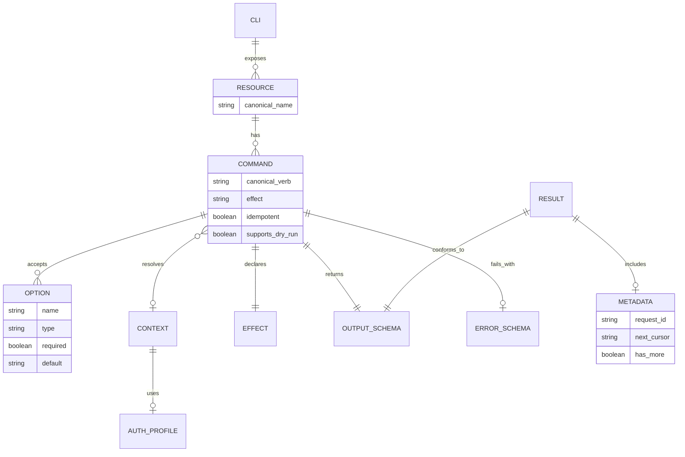
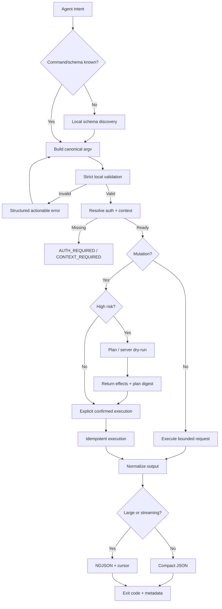

# AI 에이전트를 위한 CLI 인터페이스 설계 연구

**조사 기준일: 2026년 10월 13일**

이 보고서는 CLI를 단순히 “사람이 터미널에서 쓰는 UI”가 아니라, **LLM 기반 에이전트가 제한된 컨텍스트와 툴 호출 예산 안에서 외부 시스템을 제어하기 위한 프로토콜**로 보고 설계 원칙을 분석한다. kubectl, AWS CLI, GitHub CLI(`gh`), Git, Docker CLI, Google Cloud CLI(`gcloud`)의 공식 문서와 CLI 설계 가이드, SWE-agent의 Agent-Computer Interface 연구, 최신 Model Context Protocol(MCP) 및 OpenTelemetry 사양을 함께 검토했다. Kubernetes는 공식 한국어 문서도 제공하고 있어 한국어 자료를 우선 확인했다. citeturn11view0turn12academia26turn21view0

## 경영진 요약

결론부터 말하면, **AI가 쓰기 좋은 CLI는 “짧은 명령어”보다 “추측할 필요가 없는 CLI”**다. LLM에게 가장 비싼 것은 몇 글자를 더 생성하는 비용이 아니라, 잘못된 명령 → `--help` 조회 → 출력 해석 → 재시도 → 컨텍스트 오염으로 이어지는 **탐색과 복구의 연쇄**다.

SWE-agent 연구는 LM 에이전트를 기존 소프트웨어의 또 다른 종류의 최종 사용자로 보고, 에이전트에 맞춘 Agent-Computer Interface가 행동과 성능에 큰 영향을 줄 수 있음을 실험적으로 보여줬다. 최신 MCP 사양 역시 도구를 이름과 자연어 설명만으로 노출하는 데 그치지 않고 `inputSchema`, 선택적 `outputSchema`, 구조화된 결과를 제공하며, 도구 목록의 **결정론적 순서가 LLM prompt-cache hit rate를 개선한다**고 명시한다. 즉, “툴 인터페이스 자체가 모델 성능의 일부”라는 방향은 연구와 산업 사양 양쪽에서 이미 명확하다. citeturn12academia26turn21view0

본 조사에서 가장 중요한 권장사항을 압축하면 다음과 같다.

| 영역 | AI 친화 권장안 | 이유 |
|---|---|---|
| 명령 구조 | `cli <resource> <verb> [id]`를 기본 문법으로 고정 | 가능한 다음 토큰과 명령 후보를 빨리 좁힘 |
| positional | 식별자처럼 의미가 자명한 값 최대 1개 | 인자 순서 기억 부담 제거 |
| 나머지 입력 | 긴 이름의 명시적 `--flags` | 자기 설명적이고 순서 독립적 |
| 스키마 탐색 | `cli schema <resource> <verb> --output=json` | 긴 help를 읽는 호출 제거 |
| 출력 | bounded JSON, 스트림은 NDJSON | 인간용 텍스트 parsing 제거 |
| 필드 선택 | `--fields=id,title,state` | 출력 토큰 절약 |
| 목록 | 작은 기본 `--limit`, opaque `--cursor`; `--all`만 전체 조회 | 숨은 API 호출·컨텍스트 폭발 방지 |
| mutation | `--plan` / server-side `--dry-run`, idempotency key | 실수와 중복 실행 방지 |
| 위험 작업 | `--confirm=<plan-digest>` 같은 비대화형 명시 승인 | 에이전트를 prompt에 멈춰 세우지 않으면서 안전 확보 |
| 오류 | nonzero exit + 안정적인 문자열 `error.code` + `retryable` | 모델의 즉시 자가 교정 가능 |
| agent mode | JSON, no pager/color/spinner/prompt, strict parsing | 터미널 장식을 컨텍스트에서 제거 |
| auth/context | 현재 account/project/region/namespace를 결과 metadata에 노출 | 숨은 전역 상태로 인한 오작동 방지 |
| telemetry | canonical command, latency, calls, retries만; 인자 값/출력/secret 미수집 | 최적화에 필요한 정보와 보안 균형 |

기존 도구에서 배울 만한 패턴도 분명하다. **Git의 `--porcelain`은 “사람용 출력과 기계용 계약을 분리”하는 훌륭한 사례**, **GitHub CLI의 `--json field1,field2`는 컨텍스트 절약 면에서 특히 우수**, **kubectl의 resource grammar와 server-side dry-run은 안전한 mutation의 좋은 모델**, **AWS CLI의 JSON/JMESPath와 CLI skeleton은 탐색성을 높인다.** 반면 AWS CLI의 기본 자동 pagination은 한 명령이 뒤에서 여러 API 호출을 수행할 수 있고, `gcloud`의 강력한 filter/format DSL은 문법 학습 부담을 추가하며 일부 format attribute 오타는 조용히 무시될 수 있다. Docker는 현대적인 object namespace와 legacy top-level 명령이 공존하고, Git은 안정적인 machine format은 훌륭하지만 CLI 전체에 통일된 JSON contract가 있는 것은 아니다. citeturn8view0turn5view0turn3view1turn3view3turn3view4turn10view0turn9view0

따라서 핵심 설계 목표는 다음 식으로 요약할 수 있다.

> **Agent-friendly CLI = 낮은 명령 선택 엔트로피 + 자기 설명적 입력 스키마 + bounded structured output + 명시적 side effect + deterministic recovery**

사람에게 편한 shorthand는 추가해도 되지만, **에이전트가 사용할 canonical surface는 하나만 존재해야 한다.**

## AI 에이전트 관점의 설계 원칙

전통적인 좋은 CLI 원칙과 AI 에이전트용 좋은 CLI 원칙은 상당 부분 겹친다. Command Line Interface Guidelines 역시 positional argument보다 명시적인 flag를 선호하고, 긴 이름의 flag를 제공하며, 복잡한 CLI는 일관된 subcommand를 사용하고, 기계 처리를 위해 JSON을 제공하고, non-TTY에서는 색상과 애니메이션을 끄라고 권고한다. 그러나 AI에서는 여기에 **탐색 호출 수, 출력 토큰 수, hidden state, 자동 복구 가능성**이라는 새로운 비용 축이 추가된다. citeturn14view1

**명령 이름과 namespace.** 복잡한 제품에는 `<noun> <verb>` 구조를 우선 권장한다.

```text
acme issue list
acme issue get ISS-42
acme issue create
acme issue update ISS-42
acme issue delete ISS-42

acme project list
acme project get PRJ-7
```

CLI Guidelines는 `noun verb`와 `verb noun` 모두 가능하지만, 여러 객체와 연산을 다루는 복잡한 CLI에서는 `docker container create` 같은 두 단계 구조를 일관되게 사용하는 패턴을 제시한다. GitHub CLI 역시 `gh pr list`, `gh issue view`, `gh repo create`처럼 resource namespace 안에 동작을 배치한다. Docker도 `docker container`, `docker image`, `docker network`, `docker volume` 등의 object-management namespace를 제공한다. citeturn14view1turn17search3turn17search23turn9view0

다만 `<noun> <verb>`가 보편적인 진리는 아니다. kubectl처럼 거의 모든 객체가 동일한 Kubernetes resource model을 따르는 도구에서는 `kubectl get pods`, `kubectl delete pod NAME`, `kubectl describe TYPE NAME` 같은 `<verb> <resource>`도 매우 규칙적이다. kubectl의 공식 문법 자체가 `kubectl [command] [TYPE] [NAME] [flags]`이다. 중요한 것은 방향보다 **한 제품 안에서 규칙을 바꾸지 않는 것**이다. citeturn3view0turn3view1

특히 피해야 할 것은 의미가 겹치는 동사다.

```text
update
upgrade
modify
edit
patch
set
change
```

이들을 비슷한 맥락에 모두 노출하면 LLM은 각각의 미세한 의미를 문서에서 다시 찾아야 한다. CLI Guidelines 역시 `update`와 `upgrade`처럼 비슷한 명령 이름을 피하라고 권고한다. 따라서 CRUD에 가까운 도메인은 `list/get/create/update/delete`처럼 작은 canonical vocabulary를 유지하는 편이 낫다. citeturn14view1

**positional argument는 적게 쓴다.** 사람에게는

```bash
deploy prod payments v3 force
```

가 짧지만 에이전트에게는 `prod`, `payments`, `v3`, `force`가 무엇인지 스키마를 기억해야 한다. 다음이 더 유리하다.

```bash
acme deployment create \
  --environment=prod \
  --service=payments \
  --version=v3 \
  --force
```

CLI Guidelines도 positional은 순서가 의미를 바꾸고, 두 개 이상의 서로 다른 의미를 가진 positional이 생기면 ambiguity가 커지므로 flag를 우선하라고 권한다. AWS CLI alias 문서도 positional scripting variable이 순서에 의존하고 순서가 틀리면 오류가 발생하는 예를 보여준다. citeturn14view1turn4view1

예외는 의미가 사실상 자명한 **primary identity 하나**다.

```bash
acme issue get ISS-42
acme file delete path/to/file
```

여기서 `ISS-42`는 `get`의 유일한 대상이므로 부담이 작다. 그러나 scope, region, account, environment 같은 값은 flag로 두는 것이 좋다.

```bash
acme issue get ISS-42 --project=payments --org=acme
```

**option parser는 엄격해야 한다.** AI에게는 “친절하게 추측해 주는 parser”보다 “틀렸으면 즉시 정확히 틀렸다고 알려주는 parser”가 더 좋다. 특히 unknown flag, enum typo, incompatible combination은 반드시 실행 전에 실패시켜야 한다.

```text
ERROR:
  code: UNKNOWN_OPTION
  field: --formt
  hint: Did you mean --format?
```

단, 제안만 해야지 자동 교정 후 실행해서는 안 된다. mutation에서 `--prodcuton`을 알아서 `--production`으로 해석하는 것은 매우 위험하다.

boolean도 하나의 관례로 고정한다.

```bash
--recursive
--no-recursive
```

보다는 다음과 같은 혼용을 피해야 한다.

```bash
--recursive
--recursive=true
--disable-recursion=false
-r
```

Docker 문서가 보여주듯 boolean option에는 “기본 false인 flag”와 “기본 true라 명시적으로 false를 줘야 하는 flag”가 섞일 수 있고, multi-value option 역시 반복 입력을 허용한다. 사람에게 익숙한 유연성은 에이전트에게는 추가 문법 상태가 된다. 따라서 parser는 여러 표현을 받아도 되지만 **help/schema가 출력하는 canonical form은 단 하나**여야 한다. citeturn9view0

**`--` delimiter는 보존한다.** 다른 프로세스의 인자를 전달하는 명령에서는

```bash
acme exec task-123 -- python script.py --foo bar
```

처럼 CLI 자신의 option parsing이 끝나는 지점을 명확히 해야 한다. GitHub CLI도 `gh repo clone ... -- <gitflags>...`를 사용한다. citeturn17search11

**hidden default는 최소화한다.** kubectl은 current context/namespace, AWS CLI는 profile/region, GitHub CLI는 현재 Git repository 또는 `GH_REPO`, Docker는 context, gcloud는 configuration/project 등 유용한 ambient state를 사용한다. 이는 사람에게 매우 편하지만 자율 에이전트가 세션을 넘나들 때 “왜 이 project가 선택됐지?”라는 종류의 실수를 만들 수 있다. GitHub CLI 문서도 repository/host/token 등을 environment와 local repository context에서 추론할 수 있음을 명시한다. citeturn3view1turn19view2turn9view0

따라서 agent mode에서는 최종적으로 resolve된 context를 결과에 싣는 것을 권장한다.

```json
{
  "data": {
    "id": "ISS-42",
    "title": "Fix timeout"
  },
  "meta": {
    "context": {
      "account": "agent-prod",
      "org": "acme",
      "project": "payments",
      "region": "ap-northeast-2"
    }
  }
}
```

mutation 또는 destructive command의 경우 strict mode에서 특히 위험한 scope는 아예 명시적으로 요구할 수 있다.

**alias는 입력 호환성이지 새로운 API가 되어서는 안 된다.** 사람용으로 `ls`, `rm`, `co` 등을 허용해도 좋지만 `schema`, help, telemetry, structured error에서는 항상 canonical command로 normalize해야 한다.

```text
입력:   acme svc ls
해석:   acme service list
출력:   "command": "service.list"
```

Git은 사용자 정의 alias를 지원하고, Docker는 object-management 형태와 여러 legacy top-level 명령을 함께 노출한다. 이런 alias는 기존 사용자 경험에는 도움이 되지만 에이전트가 “둘 중 어느 쪽이 정식인가”를 추론하게 만들 수 있으므로 machine-facing discovery에는 canonical form만 노출하는 편이 좋다. citeturn1search9turn9view0

**help보다 schema가 중요하다.** 사람에게는 다음이 좋다.

```bash
acme issue create --help
```

에이전트에는 다음이 더 좋다.

```bash
acme schema issue create --output=json
```

예상 결과:

```json
{
  "command": "issue.create",
  "description": "Create an issue",
  "arguments": [],
  "options": {
    "title": {
      "type": "string",
      "required": true
    },
    "body": {
      "type": "string"
    },
    "labels": {
      "type": "array",
      "items": "string",
      "repeatable": true
    },
    "project": {
      "type": "string",
      "required": true
    }
  },
  "effects": "write",
  "supports": {
    "dry_run": true,
    "idempotency_key": true
  },
  "output_schema": "issue.v1"
}
```

이 방향은 MCP가 tool마다 `inputSchema`와 선택적 `outputSchema`를 제공하는 방식과 직접 맞닿아 있다. MCP는 tool list 역시 pagination/cache를 지원하고, 같은 tool set이면 결정론적 순서를 유지해 모델 prompt caching을 돕도록 권고한다. citeturn21view0

AWS CLI의 auto-prompt는 이 중 일부를 이미 잘 수행한다. 필수 parameter를 먼저 보여주고 type/설명을 제공하며, `--generate-cli-skeleton`으로 API 호출 없이 입력 JSON skeleton을 만들 수 있다. 반면 resource completion은 사용자 소유 resource를 제안하기 위해 실제 API 호출을 할 수 있다. **AI용 discovery/help/schema는 원칙적으로 remote side effect뿐 아니라 remote 조회 자체도 하지 않는 편이 좋다.** 그렇지 않으면 명령을 알아보기만 했는데 API call·latency·rate limit이 소모된다. citeturn4view0

GitHub CLI에는 또 다른 훌륭한 작은 패턴이 있다. JSON을 지원하는 명령에서 `--json` 뒤에 field를 지정하며, field 목록 없이 요청하면 사용 가능한 field를 확인할 수 있다. 특히 `gh pr list --json number,title,author`처럼 **필요한 field만 가져오는 형태**는 LLM 컨텍스트 절감에 효과적이다. citeturn5view0

## 실전 CLI 비교

아래 표는 여섯 가지 대표 CLI의 실제 인터페이스를 “AI 에이전트가 최소 호출·최소 컨텍스트로 사용한다”는 기준으로 비교한 것이다. 평가는 제품 우열이 아니라 **agent-facing affordance의 관점**이다.

| 도구 | 대표 문법 | 기계용 출력 | 탐색·필터·페이지 | mutation 안전성 | AI 관점의 강점 | 주요 마찰 |
|---|---|---|---|---|---|---|
| **kubectl** | `kubectl <verb> <TYPE> <NAME> [flags]` citeturn3view0 | `-o json`, YAML, JSONPath, custom columns, name 등 citeturn3view2 | selector, sort, field-oriented 조회 | 여러 명령에서 client/server dry-run; `diff` 제공 citeturn3view1 | resource model이 매우 규칙적; dry-run 모델 좋음 | current context/namespace 같은 hidden state; 출력 선택지가 많음 |
| **AWS CLI** | `aws [options] <service> <operation> [parameters]` citeturn4view2 | JSON 기본값, text/table/YAML 등; JMESPath `--query` citeturn3view3turn4view2 | 자동 pagination, `--max-items`, `--page-size`, `--starting-token` citeturn3view4 | 서비스/API별 상이; client-token idempotency가 강점 citeturn18view0 | API 모델이 체계적; skeleton/auto-prompt; JSON 기본 | 기본 auto-pagination이 숨은 여러 API call을 만들 수 있음; 명령/옵션이 매우 방대 |
| **gh** | `gh <resource> <verb>` 예: `gh pr list` citeturn17search3 | 기본은 line text; 다수 명령에서 field-selective `--json`, `--jq`, template citeturn5view0 | `gh api --paginate`, `--slurp` citeturn6view0 | 일부 명령만 dry-run; 비대화형 prompt disable 가능 citeturn17search15turn19view2 | resource-first grammar와 `--json fields`가 매우 좋음 | structured output 지원이 command별로 다름 |
| **Git** | 주로 `git <command> ...` | 일반 JSON은 없지만 `git status --porcelain`, `-z` 같은 안정 machine format 제공 citeturn8view0 | command별 filter/plumbing | 많은 명령이 precondition/atomic semantics 제공; `update-ref --stdin` batch/transaction 가능 citeturn18view1 | “사람용 porcelain과 기계용 안정 contract 분리” 철학이 강함 | command마다 출력 contract가 달라 agent wrapper가 필요 |
| **Docker** | `docker <object> <verb>` + legacy top-level commands citeturn9view0 | command별 Go template/JSON 계열 formatting, inspect 등 | command별 filtering | command별 | object namespace가 명확; global context 구조 | legacy와 modern surface가 공존; 출력 형식의 일관성이 상대적으로 낮음 |
| **gcloud** | 계층형 `gcloud <group> ... <command>` | `--format=json`, YAML, CSV, value, table 등 citeturn10view0 | 강력한 `--filter`, projections, `--limit` citeturn10view0turn10view1 | command별 | 서버/클라이언트 filtering과 출력 projection이 강력 | filter DSL이 복잡하고 API별 차이가 있으며, 일부 format attribute 오타가 조용히 무시됨 |

이 비교에서 특히 주목할 설계가 몇 가지 있다.

**Git의 `--porcelain`은 이름 그대로 machine contract를 별도로 둔다.** `git status`의 기본 long format은 사람이 읽기 쉽고 상세하지만 문서가 “언제든 변경될 수 있다”고 설명하는 반면, porcelain v1은 버전과 사용자 설정을 넘어 script용으로 안정성을 보장한다. `-z`를 쓰면 pathname을 NUL로 구분해 공백이나 특수문자 parsing 문제도 줄인다. 에이전트용 CLI에서도 이 원칙을 거의 그대로 가져올 가치가 있다. **사람용 UI와 기계용 프로토콜을 같은 텍스트 포맷으로 만족시키려고 하지 않는 것**이다. citeturn8view0

**GitHub CLI의 field projection은 토큰 최적화 측면에서 가장 직접적으로 유용하다.** 예를 들어 agent가 PR 번호와 제목만 필요하다면 전체 PR 객체를 내보내지 않고:

```bash
gh pr list --json number,title
```

처럼 요청할 수 있다. JSON 자체를 지원하는 것보다 “JSON의 어느 field를 받을지 호출자가 제한할 수 있다”는 점이 LLM 환경에서는 훨씬 중요하다. citeturn5view0

**AWS CLI의 pagination은 사람에게 편하지만 agent에게는 조심해야 할 패턴이다.** AWS CLI는 기본적으로 서비스 pagination을 따라 모든 결과를 가져올 수 있으며, 공식 문서는 예컨대 결과가 여러 서비스 페이지로 나뉘면 CLI 한 번이 여러 service call을 만든다고 설명한다. `--page-size`는 서비스 호출 한 번의 크기를 조절하고, `--max-items`는 사용자에게 반환하는 항목 수를 조절하며, continuation token을 통해 계속 조회할 수 있다. 이런 구분 자체는 훌륭하지만 “default fetch-all”은 agent 환경에서 rate limit과 context budget을 동시에 낭비할 수 있다. citeturn3view4

따라서 AI-first CLI라면 기본을 뒤집는 것이 좋다.

```text
사람 중심 전통형:
list → 가능한 모든 결과 자동 수집

AI-first:
list → bounded first page
list --all → 명시적으로 전체 수집
```

**gcloud는 강력하지만 표현력이 높을수록 에이전트가 배워야 할 mini-language도 커진다는 교훈을 준다.** `--filter`, `--format`, projection을 조합하면 서버에서 받아오는 정보와 출력량을 크게 줄일 수 있지만, filter syntax에는 quoting과 operator 의미 차이가 있고 일부 동작은 API에 따라 달라질 수 있다. 공식 문서는 format attribute 중 알려지지 않은 attribute가 조용히 무시될 수 있다고도 설명한다. 사람에게 관대한 parsing이 agent에게는 위험할 수 있는 사례다. citeturn10view0turn10view1

**kubectl은 homogeneous resource model의 힘을 보여준다.** `get`, `describe`, `delete`, `create` 같은 작은 verb 집합을 여러 resource type에 재사용하고, 여러 resource를 한 번에 지정할 수도 있다. 출력은 JSON, JSONPath, custom columns, name 등으로 축약 가능하다. `--dry-run=client|server` 계열과 `diff` 역시 mutation 전에 결과를 관찰하기 좋은 모델이다. citeturn3view1turn3view2

**Git의 batch interface도 참고할 가치가 있다.** `git update-ref --stdin`은 여러 update/create/delete/verify 작업을 stdin으로 입력받아 함께 처리하며, batch update mode에서는 각 실패를 구조적으로 보고한다. 에이전트가 100개 항목을 갱신하기 위해 CLI를 100번 실행하는 대신 “한 번의 batch 호출”을 할 수 있게 하는 것이 툴 호출 최적화의 핵심이다. citeturn18view1

종합하면 여섯 CLI에서 각각 가져올 최선의 부분은 다음과 같다.

| 가져올 패턴 | 대표 사례 |
|---|---|
| 작고 규칙적인 resource/verb vocabulary | kubectl, gh |
| namespace로 명령 공간 축소 | gh, Docker, gcloud |
| 명시적 machine contract | Git `--porcelain` |
| JSON 기본/선택 | AWS, kubectl, gcloud |
| field projection | gh `--json fields`, AWS `--query`, gcloud projection |
| dry-run / diff | kubectl |
| schema에 가까운 introspection | AWS skeleton/auto-prompt |
| batching | kubectl multi-resource, Git stdin transaction |
| explicit pagination token | AWS |
| noninteractive controls | gh prompt-disable, pager/color 환경 설정 |

어느 도구도 이 모든 특성을 하나의 일관된 agent contract로 합쳐 놓지는 않는다. 이 빈 공간이 바로 AI-first CLI가 개선할 지점이다.

## 권장 AI 친화 CLI 명세

본 보고서가 권장하는 최소 문법은 다음과 같다.

```text
<cli> [global-options] <resource> <verb> [<id>] [command-options]
```

canonical 예시는 다음과 같다.

```bash
acme issue list
acme issue get ISS-42
acme issue create --title="Timeout" --project=payments
acme issue update ISS-42 --state=closed
acme issue delete ISS-42
```

resource 안에서 사용하는 canonical verb는 가능한 한 작게 유지한다.

```text
list
get
create
update
delete

필요할 때만:
search
apply
execute
watch
```

동일 개념에 `show/view/get/read`, `remove/delete/destroy`, `modify/edit/update/set` 같은 동의어를 여러 canonical command로 만들지 않는다. 사람용 alias는 가능하지만 schema에는 하나만 나타낸다. 이는 CLI Guidelines가 subcommand 간 명명·flag·출력의 일관성을 강조하는 원칙과도 맞는다. citeturn14view1

**권장 global contract**는 다음 정도면 충분하다.

```text
--output=json|ndjson|text
--fields=<field,...>
--filter=<simple-expression>
--limit=<n>
--cursor=<opaque-token>
--all

--profile=<name>
--context=<name>

--input=<file|->
--timeout=<duration>

--dry-run=server|local
--plan
--idempotency-key=<key>
--confirm=<plan-digest>

--no-prompt
--no-color
--no-pager

--request-id=<id>
--meta=<none|minimal|full>
```

그리고 별도의 agent mode를 둘 것을 강하게 권장한다.

```bash
acme --agent ...
```

또는

```bash
ACME_AGENT=1 acme ...
```

`--agent`의 의미는 단순 alias가 아니라 **프로토콜 프로파일**이어야 한다.

```text
--output=json
--no-prompt
--no-color
--no-pager
spinner/progress off
unknown option = hard error
stable timestamps
stable ordering when semantically possible
bounded list output
machine-readable error
```

GitHub CLI는 실제로 prompt를 끄는 `GH_PROMPT_DISABLED`, ANSI color를 끄는 `NO_COLOR`, pager 제어, spinner 변경 등의 환경 설정을 제공한다. 이러한 기능을 agent mode 하나로 통합하는 것이 목적이다. citeturn19view2turn19view3

**bounded JSON의 권장 성공 envelope**는 다음과 같다.

```json
{
  "data": [
    {
      "id": "ISS-42",
      "title": "Timeout",
      "state": "open"
    }
  ],
  "meta": {
    "command": "issue.list",
    "returned": 1,
    "has_more": true,
    "next_cursor": "cur_eyJ...",
    "context": {
      "project": "payments"
    },
    "request_id": "req_7f4..."
  }
}
```

`meta`까지 매번 장황하게 반환하면 역시 토큰을 먹으므로 기본값은 작은 `minimal`이어야 한다. `next_cursor`, warning, retry 정보 등 필요한 항목만 등장시키고, 상세 timing이나 backend 정보는 `--meta=full`에서 요청하도록 할 수 있다.

**대용량 스트림은 NDJSON**을 권장한다.

```jsonl
{"id":"ISS-1","state":"open"}
{"id":"ISS-2","state":"closed"}
{"id":"ISS-3","state":"open"}
```

배열 하나가 완성될 때까지 기다릴 필요 없이 record 단위로 소비할 수 있고, 긴 로그·event stream·bulk result와 궁합이 좋다. 반대로 결과 크기가 작고 bounded한 일반 조회에서는 JSON object/array가 다루기 쉽다.

필드 projection은 일급 기능이어야 한다.

```bash
acme issue list \
  --state=open \
  --fields=id,title \
  --limit=20 \
  --output=json
```

에이전트가 “열린 issue 20개의 제목”을 요구받았을 때 description, timestamps, author profile, labels, linked objects 등을 모두 컨텍스트에 집어넣을 이유가 없다. GitHub CLI의 field-selective JSON과 AWS CLI의 JMESPath `--query`, gcloud projection이 각각 이 문제를 해결하는 실제 선례다. citeturn5view0turn3view3turn10view0

**검색/filter는 의도적으로 작게 설계**하는 편이 좋다. SQL/JMESPath/JSONPath 수준의 강력한 DSL을 CLI 자체에 또 만드는 대신 흔한 equality/range 몇 가지를 제공한다.

```bash
--state=open
--created-after=2026-10-01
--owner=alice
```

복합 검색이 꼭 필요하다면 명시적으로:

```bash
--filter='state == "open" && priority >= 3'
```

를 제공하되, 문법 오류나 unknown field는 반드시 hard error로 처리한다.

**schema discovery는 다음과 같이 작동해야 한다.**

```bash
acme schema issue update --output=json
```

```json
{
  "command": "issue.update",
  "effect": "write",
  "id": {
    "type": "string",
    "required": true,
    "positional": true
  },
  "options": {
    "title": {"type":"string"},
    "state": {
      "type":"string",
      "enum":["open","closed"]
    },
    "assignee": {"type":"string"}
  },
  "supports": {
    "dry_run": true,
    "idempotency": true
  }
}
```

또한 전체 command tree를 매번 수천 줄 반환하지 말고:

```bash
acme schema
acme schema issue
acme schema issue update
```

처럼 점진적으로 좁힐 수 있어야 한다. MCP의 `tools/list`가 pagination/cache를 제공하고 input/output JSON Schema를 명시하는 구조는 이 설계에 좋은 참조가 된다. citeturn21view0

명령과 객체의 관계를 모델링하면 다음과 같다.



**좋지 않은 설계와 권장 설계**를 나란히 놓으면 차이가 더 명확하다.

| 나쁜 예 | 좋은 예 | 이유 |
|---|---|---|
| `deploy prod payments v3 true` | `deployment create --environment=prod --service=payments --version=v3 --force` | positional 의미 추론 제거 |
| `user list` → 80,000건 출력 | `user list --limit=50 --fields=id,name` | 토큰/API 호출 상한 |
| `rm server-1` → `Are you sure? [y/N]` | `server delete server-1 --plan`, 이후 `--confirm=<digest>` | 비대화형 안전 실행 |
| `--formt=json`을 무시하고 text 출력 | `UNKNOWN_OPTION`, `did_you_mean: --format` | fail-fast |
| human table만 제공 | `--output=json` | parsing 단계 제거 |
| `create` timeout 후 재실행 → 중복 생성 | 동일 `--idempotency-key` 재사용 | retry 안전성 |
| 400줄 `--help`만 존재 | `schema resource verb --output=json` | discovery context 절감 |
| `get`을 필드별로 5번 호출 | 한 번의 `--fields=a,b,c,d,e` | tool-call 감소 |
| current project가 묵시적 | 결과에 `meta.context.project` 노출 | wrong-context 탐지 |
| 100개 수정에 CLI 100회 | NDJSON stdin batch | process/tool-call 감소 |

**batch 입력**은 JSON/NDJSON stdin을 추천한다.

```bash
acme issue update --input=- --output=ndjson <<'EOF'
{"id":"ISS-1","state":"closed"}
{"id":"ISS-2","state":"closed"}
{"id":"ISS-3","assignee":"alice"}
EOF
```

각 결과도 한 줄씩 돌려준다.

```jsonl
{"id":"ISS-1","ok":true,"changed":true}
{"id":"ISS-2","ok":true,"changed":false}
{"id":"ISS-3","ok":false,"error":{"code":"NOT_FOUND"}}
```

Git의 `update-ref --stdin`이 여러 작업을 한 transaction/batch로 처리하고 batch failure를 식별하는 것은 이 패턴의 좋은 선례다. citeturn18view1

## 오류·안전·운영 설계

에이전트 CLI에서 **오류는 documentation의 일부**다. CLI Guidelines도 사용자가 문서를 찾는 가장 흔한 이유 중 하나가 오류 해결이며, 오류 자체를 실행 가능한 안내로 만들면 탐색 비용을 줄일 수 있다고 지적한다. MCP 사양 역시 malformed request 같은 protocol error와, 모델이 수정 후 재시도할 수 있는 validation/API/business-logic execution error를 구분하며 후자는 모델에게 제공해 self-correction을 가능하게 하라고 권한다. citeturn14view1turn21view0

성공 시 stdout:

```json
{
  "data": {
    "id": "ISS-42"
  }
}
```

실패 시 nonzero exit와 구조화된 error:

```json
{
  "error": {
    "code": "INVALID_ENUM",
    "message": "Invalid value for --state.",
    "field": "state",
    "received": "done",
    "expected": ["open", "closed"],
    "retryable": false,
    "hint": "Use --state=closed."
  },
  "meta": {
    "request_id": "req_f03..."
  }
}
```

문자열 error code를 **주 계약**으로 삼고 exit code는 거친 class로만 사용한다. 본 보고서의 권장 mapping은 다음과 같다.

| Exit | 의미 | 대표 문자열 code |
|---:|---|---|
| `0` | 성공 | `OK` |
| `2` | invocation/schema 오류 | `UNKNOWN_OPTION`, `INVALID_ARGUMENT` |
| `10` | 인증·권한 | `AUTH_REQUIRED`, `PERMISSION_DENIED` |
| `20` | domain/precondition | `NOT_FOUND`, `CONFLICT`, `PRECONDITION_FAILED` |
| `30` | 일시적 실패 | `RATE_LIMITED`, `NETWORK_ERROR`, `SERVICE_UNAVAILABLE` |
| `40` | batch 일부 실패 | `PARTIAL_FAILURE` |

이 숫자 자체는 업계 표준을 주장하는 것이 아니라 **새 CLI를 위한 제안**이다. 중요한 것은 release마다 바뀌지 않는 것과, 모델이 숫자 하나를 암기할 필요 없이 `error.code`, `retryable`, `retry_after_ms`를 얻는 것이다. GitHub CLI도 현재 성공 `0`, 일반 실패 `1`, cancel `2`, authentication required `4`처럼 제한된 exit code를 문서화한다. citeturn6view2

오류에는 적어도 다음 정보가 필요하다.

```text
code
message
field / path
received
expected       # type/enum/range일 때
retryable
retry_after_ms # 필요한 경우
hint           # 실제로 실행 가능한 수정안
request_id
```

반대로 stack trace, SDK 내부 class명, 수십 줄의 HTTP dump는 기본 오류에 넣지 않는다. 디버그 모드에서만 제공한다. CLI Guidelines도 신호 대 잡음비를 중시하고 예상 가능한 오류를 사람이 이해할 형태로 다시 쓰며, 내부 debug 정보는 기본 출력에서 제외할 것을 권한다. citeturn14view1

**idempotency는 에이전트 시대에 선택 기능이 아니라 핵심 기능**에 가깝다. 에이전트 실행에서는 timeout 이후 “명령이 실패했는지, 성공했는데 응답만 잃었는지” 알 수 없는 상황이 흔하기 때문이다. AWS EC2 공식 문서는 바로 이 문제를 설명한다. mutation이 이미 성공했는데 재시도하면 resource가 중복 생성될 수 있으며, client token을 같은 parameter와 재사용하면 추가 작업 없이 성공하도록 하는 idempotency를 지원한다. parameter가 달라지면 `IdempotentParameterMismatch`로 실패시킨다. citeturn18view0

권장 방식은 다음과 같다.

```bash
acme deployment create \
  --service=payments \
  --version=v3 \
  --idempotency-key=job-8c1d6
```

동일 key + 동일 semantic request:

```text
첫 호출: deployment 생성
재호출: 기존 결과 반환, 새 deployment 생성하지 않음
```

동일 key + 다른 request:

```json
{
  "error": {
    "code": "IDEMPOTENCY_KEY_REUSED",
    "retryable": false
  }
}
```

`toggle`, `increment`, `append`처럼 본질적으로 재시도 위험이 큰 operation은 특별한 이유가 없는 한 피하고, 원하는 최종 상태를 표현하는 `set`, `apply`, `update`를 제공하는 것이 좋다.

**dry-run은 실제 실행과 최대한 같은 validation path를 지나야 한다.** kubectl이 client-side와 server-side dry-run을 구분하는 것이 유용한 이유다. local dry-run은 parser와 local validation만 확인하고, server dry-run은 서버의 admission/validation까지 거칠 수 있다. citeturn3view1

추천 UX:

```bash
acme server delete srv_123 --plan --output=json
```

```json
{
  "plan": {
    "operation": "server.delete",
    "target": "srv_123",
    "effects": [
      {"type":"delete","resource":"server/srv_123"},
      {"type":"detach","resource":"volume/vol_91"}
    ],
    "risk": "high",
    "digest": "sha256:ab91..."
  }
}
```

실행:

```bash
acme server delete srv_123 \
  --confirm=sha256:ab91... \
  --idempotency-key=task-481
```

이 방식은 흔한 interactive `Are you sure?`보다 agent에게 적합하다. CLI Guidelines도 심각한 destructive operation은 단순 y/n보다 대상 이름을 확인하게 하고 script에서 `--confirm="name"`처럼 전달할 수 있게 하는 방식을 제안한다. MCP 역시 sensitive operation에 사용자 confirmation을 두고 tool input을 실행 전 보여주는 것을 권한다. citeturn14view1turn21view0

`plan digest` 방식은 그 원칙을 agent 환경에 더 강하게 적용한 본 보고서의 제안이다. 승인한 계획과 실제 실행하려는 계획이 달라졌다면 CLI가 거부할 수 있다.

**pagination은 agent용으로 보수적으로 설계해야 한다.**

```bash
acme user list
```

가 10만 명을 자동으로 모두 받아서는 안 된다.

권장:

```bash
acme user list --limit=50
```

```json
{
  "data": [...],
  "meta": {
    "returned": 50,
    "has_more": true,
    "next_cursor": "cur_xxx"
  }
}
```

계속 필요할 때만:

```bash
acme user list --limit=50 --cursor=cur_xxx
```

그리고 정말 전부 필요할 때만:

```bash
acme user list --all
```

AWS CLI가 `--page-size`, `--max-items`, `--starting-token`, `--no-paginate`를 구분하는 점은 좋지만, 기본적으로 모든 service page를 순차적으로 가져오는 경우가 있어 CLI 한 번이 여러 backend 요청으로 증폭될 수 있다. agent-first 도구에서는 **`--limit`(사용자 결과 수)와 backend `page-size`를 분리하되 fetch-all은 opt-in**으로 두는 편을 권장한다. citeturn3view4

**rate limit은 CLI가 backend 정보를 번역해 agent에게 직접 줘야 한다.** agent가 별도의 `rate-limit status` 명령을 호출하게 만들지 않는 것이 좋다.

```json
{
  "error": {
    "code": "RATE_LIMITED",
    "retryable": true,
    "retry_after_ms": 32000
  },
  "meta": {
    "rate_limit": {
      "remaining": 0,
      "reset_at": "2026-10-13T08:31:02Z"
    }
  }
}
```

GitHub REST API는 response의 `x-ratelimit-*` headers를 현재 상태의 authoritative source로 사용하고, `403`/`429` 시 `retry-after` 또는 reset 시각에 맞춰 재시도하며 반복 실패 시 exponential backoff 후 포기하도록 안내한다. CLI가 이 정보를 표준화해 전달하면 agent가 HTTP-specific 규칙을 별도로 알 필요가 없다. citeturn19view0turn19view1

자동 retry는 bounded해야 한다.

```text
max_retries = 2 or 3
retry only if retryable=true
respect retry_after
never blindly retry non-idempotent mutation
return attempts count
```

**authentication은 “에이전트가 누구로 실행 중인지” 관찰 가능해야 한다.**

```bash
acme auth status --output=json
```

```json
{
  "authenticated": true,
  "account": "bot-payments",
  "profile": "prod-agent",
  "tenant": "acme",
  "expires_at": "2026-10-13T12:00:00Z",
  "scopes": [
    "issues:read",
    "issues:write"
  ]
}
```

token 자체는 절대 반환하지 않는다. GitHub CLI는 `GH_TOKEN` 등의 비대화형 token source, host/repository context 및 prompt disable을 공식 지원한다. Docker는 credential store/helper 메커니즘을 지원하고, Docker 설정 파일이 authentication 정보 같은 민감 데이터를 포함할 수 있음을 경고한다. 이처럼 agent CLI도 interactive browser login에 의존하지 않는 credential path와 secure credential store/workload identity를 지원해야 한다. citeturn19view2turn9view0

agent mode에서 auth가 없으면 브라우저를 갑자기 띄우지 않고:

```json
{
  "error": {
    "code": "AUTH_REQUIRED",
    "retryable": false,
    "hint": "Authenticate the profile before retrying."
  }
}
```

처럼 즉시 실패해야 한다.

**secret은 CLI argument로 직접 받지 않는 것이 좋다.** CLI Guidelines는 password를 flag 값으로 받으면 process listing과 shell history에 노출될 수 있다고 경고한다. 가능한 credential store, secure stdin, OS keychain, workload credential을 사용한다. citeturn14view1

**sandbox와 안전성**은 CLI syntax만으로 해결되지 않는다. agent runner 차원에서 다음 경계를 함께 적용해야 한다.

```text
filesystem root
allowed working directories
allowed network hosts
credential scope
maximum execution time
maximum output bytes
maximum subprocesses
maximum API calls
read/write/destructive capability policy
```

MCP 최신 사양도 server가 input validation, access control, invocation rate limiting, output sanitization을 구현해야 하며 client는 sensitive tool confirmation, result validation, timeout, audit logging 등을 고려해야 한다고 규정한다. citeturn21view0

특히 shell injection을 줄이려면 agent runner가 다음 문자열을 생성해서 다시 shell에 해석시키는 구조보다:

```python
"acme issue get " + user_supplied_id
```

프로세스 API에 argv vector로 넘기는 방식이 안전하다.

```text
["acme", "issue", "get", user_supplied_id]
```

untrusted bulk payload는 command line quoting보다 JSON stdin으로 전달하는 것이 낫다.

**telemetry는 CLI 개선에 매우 중요하지만 원문 argument를 보내서는 안 된다.** GitHub CLI는 현재 telemetry를 지원하면서 `GH_TELEMETRY=false`/`0` 또는 `DO_NOT_TRACK`으로 비활성화할 수 있고, telemetry 데이터를 전송하는 대신 stderr에 기록하는 모드도 제공한다. OpenTelemetry는 trace, metric, log를 shared context로 연계하는 표준 관측 모델을 제공하며, 공식 보안 문서는 민감한 정보를 가장 잘 보호하는 방법은 애초에 수집하지 않는 것이라고 설명하고 attribute/filter/redaction processor 등을 제공한다. citeturn19view3turn14view2turn15search13

AI CLI에서 권장하는 telemetry event는 이런 정도다.

```json
{
  "command": "issue.list",
  "cli_version": "4.2.0",
  "agent_mode": true,
  "duration_ms": 182,
  "exit_class": "success",
  "items_returned": 20,
  "stdout_bytes": 1842,
  "backend_requests": 1,
  "retries": 0,
  "schema_help_used": false
}
```

수집하지 않을 항목:

```text
issue title/body
file contents
shell command payload
token/password
raw stdout/stderr
arbitrary flag values
personal identifiers
```

이 telemetry를 통해 “어느 명령에서 agent가 help를 두 번씩 부르는가”, “어느 list가 평균 300KB를 출력하는가”, “어떤 option typo가 반복되는가”를 제품 차원에서 측정할 수 있다.

전체 command flow는 다음처럼 만드는 것이 이상적이다.



## 평가 방법과 테스트

“우리가 만든 CLI가 AI 친화적인 것 같다”는 주관적 평가는 충분하지 않다. SWE-agent 연구가 보여주는 핵심 중 하나도 **동일한 LM이라도 interface가 달라지면 agent behavior와 task performance가 달라질 수 있다**는 점이다. 따라서 CLI 자체를 agent benchmark 대상으로 취급해야 한다. citeturn12academia26

가장 중요한 지표는 명령어 글자 수가 아니다.

| 지표 | 정의 | 무엇을 잡아내는가 |
|---|---|---|
| **Task Success Rate** | 목표 작업을 정확히 완료한 비율 | 최종 usability |
| **First-command validity** | 첫 명령이 parse/schema validation을 통과한 비율 | 명령 문법의 추측 가능성 |
| **Tool calls / success** | 성공 작업당 CLI invocation 수 | discovery·recovery 비용 |
| **Discovery calls / task** | help/schema/completion 호출 수 | 인터페이스 자기 설명성 |
| **Output tokens / success** | 성공까지 CLI 출력이 차지한 모델 token | context 효율 |
| **Output bytes / result item** | 반환 item당 출력량 | projection 효율 |
| **Recovery depth** | 오류 후 성공까지 추가 호출 수 | error actionability |
| **Parse failure rate** | structured output parsing 실패율 | machine contract 안정성 |
| **Wrong-context rate** | 잘못된 project/account/namespace에서 실행한 비율 | hidden state 위험 |
| **Duplicate side-effect rate** | retry로 중복 resource가 생성되는 비율 | idempotency |
| **Noninteractive stall rate** | prompt/pager/editor 때문에 멈춘 비율 | agent-mode 완성도 |
| **Unconfirmed destructive effect** | 승인 없이 위험 변경이 발생한 횟수 | safety |
| **API amplification** | CLI invocation 한 번당 backend request 수 | pagination/lookup 비용 |
| **p50/p95 task latency** | agent가 목표를 끝내는 총 시간 | 실사용 속도 |
| **Rate-limit recovery rate** | 429/throttle 후 올바르게 복구한 비율 | retry contract |
| **Backward-schema compatibility** | 이전 agent가 새 CLI에서 계속 동작하는 비율 | interface 안정성 |

토큰 수는 특정 모델 tokenizer에 따라 달라지므로 절대값보다 **동일 모델·동일 task suite에서 A/B 비교**하는 것이 중요하다. 토큰은 모델이 텍스트를 처리하는 기본 단위이고 단어 수와 일치하지 않을 수 있다. citeturn17search6

특히 다음 세 지표를 함께 보면 좋다.

\[
\text{Calls per Success}
=
\frac{\text{전체 CLI 호출 수}}
{\text{성공한 task 수}}
\]

\[
\text{Context Cost per Success}
=
\frac{\text{CLI 출력 token 총합}}
{\text{성공한 task 수}}
\]

\[
\text{Recovery Cost}
=
\text{실패 후 성공까지의 추가 호출 수}
\]

어떤 CLI가 첫 명령 성공률은 높아도 모든 list 결과를 수 MB씩 반환한다면 agent-friendly라고 보기 어렵다. 반대로 아주 압축된 CLI라도 매번 option 이름을 찾으려고 help를 세 번 호출한다면 역시 좋지 않다.

아래와 같은 regression suite를 권장한다.

| 테스트 | 주어진 목표 | 합격 조건 |
|---|---|---|
| Cold discovery | 문서를 사전 주입하지 않고 “열린 issue 10개 제목 가져오기” | schema/help 최대 한 번 후 정확한 bounded 호출 |
| Field minimization | ID와 state만 필요한 조회 | 불필요한 body/profile 등 미반환 |
| Unknown flag | `--formt=json` | 실행 없이 deterministic error + `--format` 제안 |
| Invalid enum | `--state=done` | allowed enum 반환, side effect 없음 |
| Huge collection | 100,000 objects 존재 | default invocation이 전체를 fetch하지 않음 |
| Pagination | 두 번째 page 필요 | `next_cursor`를 한 번 사용해 계속 조회 |
| Rate limit | 첫 요청 429 | retryable + retry delay에 따라 bounded retry |
| Expired auth | credential 만료 | browser/prompt 없이 즉시 `AUTH_REQUIRED` |
| Hidden context | 현재 project가 예상과 다름 | result metadata에서 감지 가능 |
| Create timeout | server에서는 성공했지만 응답 timeout | 동일 idempotency key retry 시 resource 하나만 존재 |
| Destructive action | production server 삭제 | 승인/digest 없이 mutation 불가 |
| Stale plan | plan 이후 target 상태 변경 | confirm 실행을 precondition failure로 거부 |
| Batch mixed result | 100개 중 3개 invalid | 97개/3개 결과를 item별 식별 또는 atomic 정책에 맞게 전체 rollback |
| Special characters | 이름에 space/newline/`--` 존재 | argv/JSON parsing이 깨지지 않음 |
| No TTY | CI/agent environment | ANSI, spinner, pager, interactive prompt 없음 |
| Output purity | JSON 모드 실행 | stdout 전체가 schema-valid JSON/NDJSON |
| Compatibility | CLI minor upgrade | 기존 command/schema field 의미가 유지 |
| Alias canonicalization | human alias 사용 | result/telemetry에는 canonical command 표기 |
| Discovery isolation | schema/completion 실행 | 원격 API 호출 0회 |
| Injection | untrusted value에 shell metacharacters | command structure로 해석되지 않고 데이터로만 전달 |

초기 출시 시에는 아래 항목을 **절대 조건**으로 두는 것을 권한다. 이는 업계 통계가 아니라 이 보고서가 제안하는 engineering acceptance criteria다.

| 항목 | 권장 출시 목표 |
|---|---:|
| JSON/NDJSON parse 성공률 | 100% |
| unknown option fail-fast | 100% |
| agent mode interactive stall | 0 |
| 승인되지 않은 destructive side effect | 0 |
| 동일 idempotency key의 중복 side effect | 0 |
| schema discovery의 remote request | 0 |
| secret의 telemetry 수집 | 0 |
| error에 stable machine code 존재 | 100% |
| list command에 bounded 기본값 존재 | 100% |

나머지 `tool calls/success`, 출력 token, p95 latency 등은 현재 CLI를 baseline으로 잡아 릴리스마다 개선한다.

실제 agent usability 실험에서는 최소한 **read-only, search/list, create/update, destructive, bulk, rate-limit/auth failure** 작업을 섞어야 한다. 동일 task를 human-oriented mode와 agent mode에서 실행한 후 성공률뿐 아니라 호출 수와 출력 토큰을 측정한다. 한 모델 하나로만 테스트하기보다는 모델·temperature 또는 seed를 바꿔 interface의 강건성을 확인하는 편이 좋다. 이 접근은 “특정 prompt에 우연히 잘 맞는 CLI”와 “interface 자체가 예측 가능한 CLI”를 구분하는 데 도움이 된다. ACI가 agent behavior에 실제 영향을 준다는 점은 SWE-agent 연구와도 일치한다. citeturn12academia26

## 구현 체크리스트와 결론

다음 표를 AI-facing CLI의 구현 체크리스트로 바로 사용할 수 있다.

| 영역 | 출시 전 체크 |
|---|---|
| **문법** | ☐ canonical grammar가 하나다. ☐ resource/verb 순서를 전체 CLI에서 유지한다. ☐ 비슷한 동의어 command를 늘리지 않는다. |
| **positional** | ☐ 서로 다른 의미의 positional을 여러 개 요구하지 않는다. ☐ scope/context 값은 named flag다. |
| **flags** | ☐ 모든 중요한 option에 long name이 있다. ☐ boolean naming이 일관된다. ☐ unknown flag는 hard error다. ☐ `--` passthrough 경계가 명확하다. |
| **defaults** | ☐ 변경 가능한 hidden default가 문서화된다. ☐ resolved account/project/region/context를 agent가 관찰할 수 있다. ☐ destructive operation의 위험한 scope는 묵시적으로 바뀌지 않는다. |
| **namespace** | ☐ 복잡한 명령군을 resource namespace로 나눈다. ☐ alias는 canonical command로 normalize한다. |
| **discovery** | ☐ `schema <resource> <verb> --output=json`이 있다. ☐ required/type/enum/default/effect를 반환한다. ☐ discovery는 원격 API를 호출하지 않는다. |
| **help** | ☐ 짧은 synopsis와 최소 예제가 있다. ☐ installed version과 help가 일치한다. ☐ 수백 줄 help를 읽지 않고 특정 command schema를 조회할 수 있다. |
| **output** | ☐ JSON contract가 안정적이다. ☐ streaming/bulk에는 NDJSON이 있다. ☐ JSON stdout에 progress/log가 섞이지 않는다. ☐ machine mode에서 ANSI/pager/spinner가 꺼진다. |
| **projection** | ☐ `--fields`가 있다. ☐ filtering과 projection을 가능하면 server 쪽에 push down한다. |
| **pagination** | ☐ list의 default가 bounded다. ☐ opaque cursor를 반환한다. ☐ `--all`은 명시적이다. ☐ 반환 limit과 backend page size를 혼동하지 않는다. |
| **error** | ☐ 안정적인 string `error.code`가 있다. ☐ `field`, `expected`, `retryable`, `hint`를 필요한 경우 제공한다. ☐ stack trace는 기본 출력에 없다. |
| **mutation** | ☐ validation이 side effect보다 먼저 수행된다. ☐ dry-run/plan을 제공한다. ☐ high-risk action은 명시적 승인 contract가 있다. |
| **idempotency** | ☐ create/execute 계열에서 key 기반 retry 안전성을 제공한다. ☐ 동일 key + 다른 payload를 거부한다. |
| **concurrency** | ☐ version/etag/resource-version 같은 precondition을 사용할 수 있다. ☐ stale plan을 감지할 수 있다. |
| **batch** | ☐ 반복 CLI invocation 대신 stdin JSON/NDJSON bulk 입력을 지원한다. ☐ partial failure 결과가 item별로 식별된다. ☐ atomic/non-atomic 정책이 명확하다. |
| **rate limit** | ☐ rate-limit 오류가 별도 상태 조회 없이 retry 시점을 알려준다. ☐ retry 횟수에 상한이 있다. ☐ non-idempotent mutation을 무조건 재시도하지 않는다. |
| **auth** | ☐ noninteractive credential 방식이 있다. ☐ `auth status --json`이 identity/scope/expiry를 알려준다. ☐ secret을 결과로 출력하지 않는다. |
| **agent mode** | ☐ prompt/editor/browser launch가 없다. ☐ structured output과 strict parser가 강제된다. ☐ 모든 작업에 timeout이 있다. |
| **sandbox** | ☐ filesystem/network/credential scope를 제한할 수 있다. ☐ argv를 문자열 shell command로 재조립하지 않는다. ☐ output size·process/API-call budget이 있다. |
| **telemetry** | ☐ canonical command, latency, exit class, backend-call 수를 측정한다. ☐ argument value/raw output/secrets는 기본 미수집이다. ☐ opt-out이 문서화된다. |
| **compatibility** | ☐ machine schema 변경은 additive를 우선한다. ☐ field/enum 제거에는 deprecation 기간이 있다. ☐ contract regression test가 CI에 있다. |

CLI Guidelines도 subcommand, argument, flag, configuration, environment variable 모두가 외부 interface이며, 가능한 한 additive하게 진화하고 호환성을 함부로 깨지 말 것을 강조한다. AI 에이전트가 CLI 위에 장기간 workflow를 쌓기 시작하면 이 원칙은 사람용 script에서보다도 더 중요해진다. citeturn14view1

최종적으로 추천하는 **최소 AI-first CLI**는 아래 정도로 요약할 수 있다.

```text
Grammar:
  acme [--agent] <resource> <verb> [id] [flags]

Discovery:
  acme schema [resource [verb]] --output=json

Read:
  acme issue list \
    --state=open \
    --fields=id,title \
    --limit=20 \
    --output=json

Pagination:
  acme issue list \
    --limit=20 \
    --cursor=<opaque>

Write:
  acme issue update ISS-42 \
    --state=closed \
    --idempotency-key=<key> \
    --output=json

Plan:
  acme server delete srv-1 \
    --plan \
    --output=json

Confirmed write:
  acme server delete srv-1 \
    --confirm=<plan-digest> \
    --idempotency-key=<key> \
    --output=json

Batch:
  acme issue update \
    --input=- \
    --output=ndjson

Auth:
  acme auth status --output=json
```

그리고 성공 결과는 작고 예측 가능하게:

```json
{
  "data": {
    "id": "ISS-42",
    "state": "closed"
  },
  "meta": {
    "request_id": "req_123"
  }
}
```

오류도 작고 예측 가능하게:

```json
{
  "error": {
    "code": "CONFLICT",
    "message": "Resource changed since the plan was created.",
    "retryable": false,
    "hint": "Run --plan again."
  },
  "meta": {
    "request_id": "req_124"
  }
}
```

이 설계에서 가장 중요한 포인트는 JSON 자체도, noun-first syntax 자체도 아니다. **에이전트가 다음 행동을 추측하지 않아도 된다는 것**이다.

좋은 agent-facing CLI에서는 모델이:

```text
무슨 명령이지?
→ help

어떤 option이지?
→ help

출력이 뭔 뜻이지?
→ parsing/reasoning

더 있는 건가?
→ 다시 조회

실행됐나?
→ 상태 조회

timeout인데 재시도해도 되나?
→ 추론

지금 어느 project지?
→ 별도 조회
```

라는 경로를 반복하지 않는다.

대신 한 번의 schema discovery 이후:

```text
정확한 command
→ 정확한 typed args
→ bounded structured response
→ 명확한 cursor 또는 완료
```

로 끝난다. mutation에서도:

```text
plan
→ effect 관찰
→ explicit confirmation
→ idempotent execution
→ structured result
```

이라는 정형화된 흐름을 탄다.

이는 현재 산업 표준의 방향과도 맞는다. MCP는 tool의 입력·출력 schema, structured content, deterministic discovery, actionable execution error를 명시하고 있고, SWE-agent 연구는 Agent-Computer Interface 자체가 모델의 행동과 성능을 실질적으로 바꿀 수 있음을 보여준다. Git은 오래전부터 human output과 stable machine output을 구분하고 있으며, gh는 field-level projection, kubectl은 resource grammar와 dry-run, AWS CLI는 typed API surface와 structured output/pagination, gcloud는 projection/filter, Docker는 object namespace라는 각기 유용한 조각을 제공하고 있다. citeturn21view0turn12academia26turn8view0turn5view0turn3view1turn3view3turn10view0turn9view0

따라서 새 CLI를 AI 에이전트의 핵심 인터페이스로 만들 계획이라면, 가장 적절한 정신 모델은 **“CLI를 사람이 읽는 텍스트 UI로 만든 뒤 JSON 옵션을 추가한다”가 아니라 “typed RPC/API를 설계한 뒤 shell-friendly syntax와 사람용 presentation을 얹는다”**에 가깝다. 사람용 alias, 표, 색상, autocomplete는 그 위에 얼마든지 추가할 수 있다. 반대로 stable schema, bounded output, explicit effects, idempotency를 나중에 덧붙이려 하면 이미 만들어진 command grammar와 script compatibility 때문에 훨씬 고치기 어렵다. CLI interface는 장기 호환성을 갖는 외부 계약이라는 기존 CLI 설계 원칙과, schema 기반 도구 호출을 지향하는 최신 agent protocol 양쪽이 이 결론을 뒷받침한다. citeturn14view1turn21view0